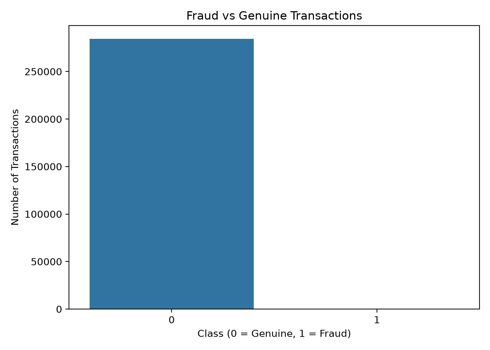
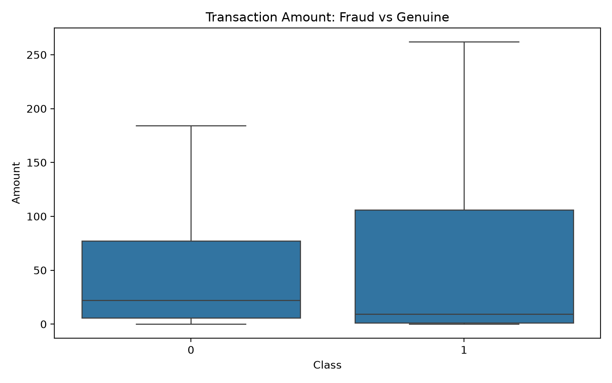
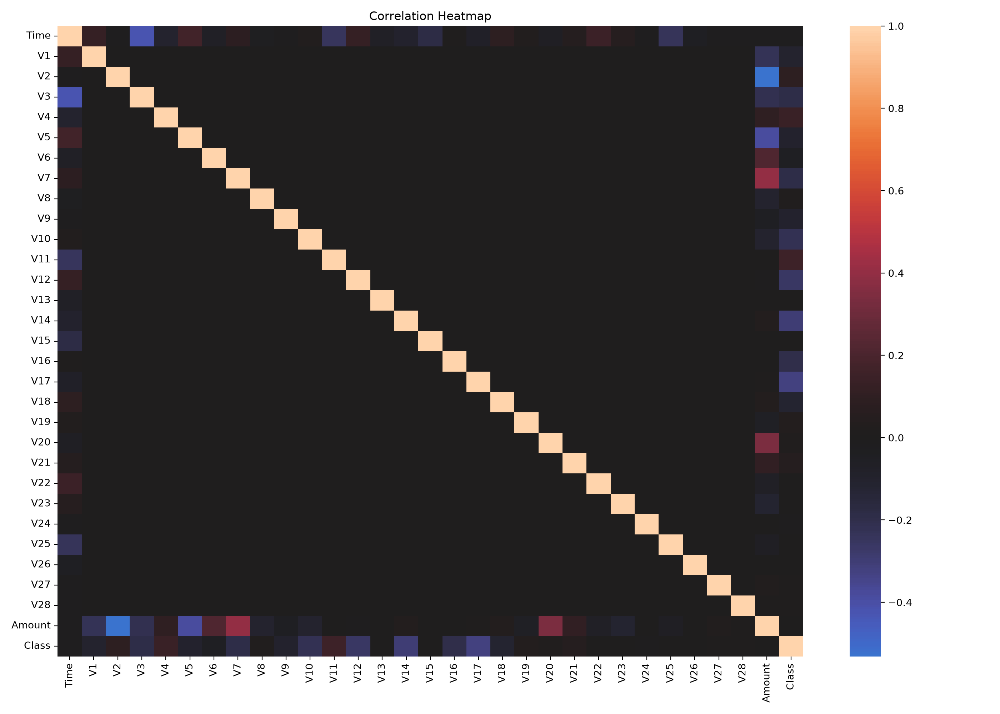
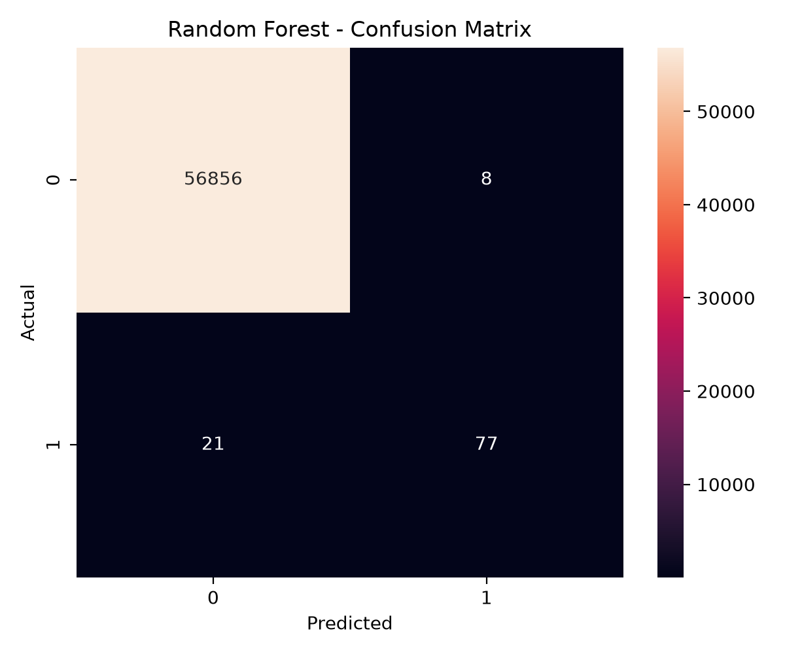
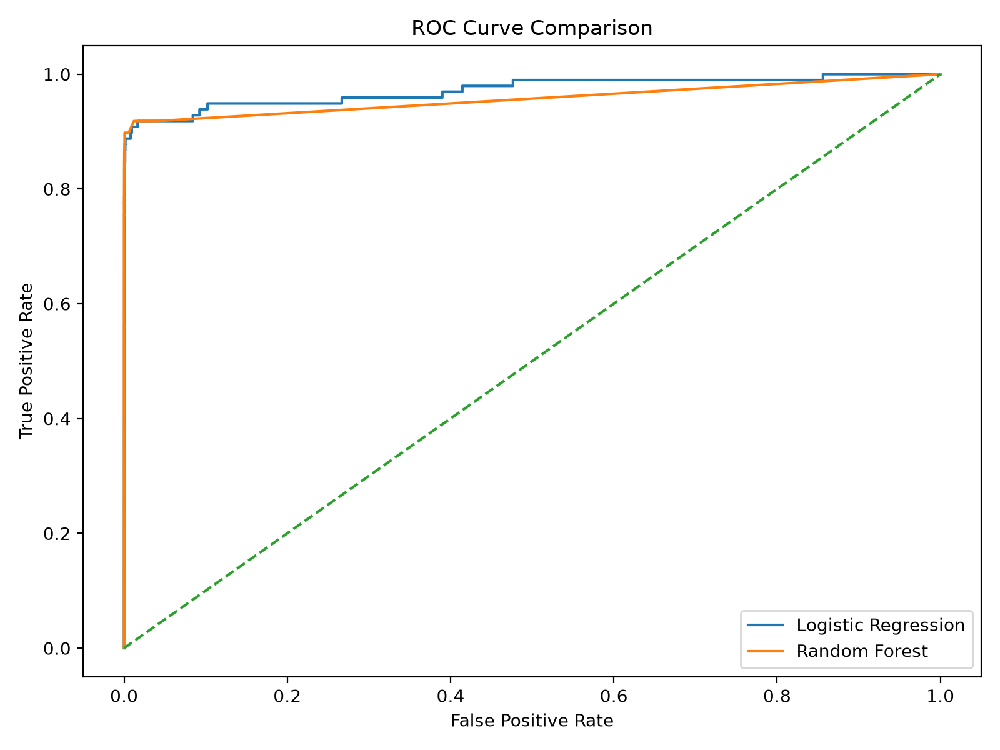
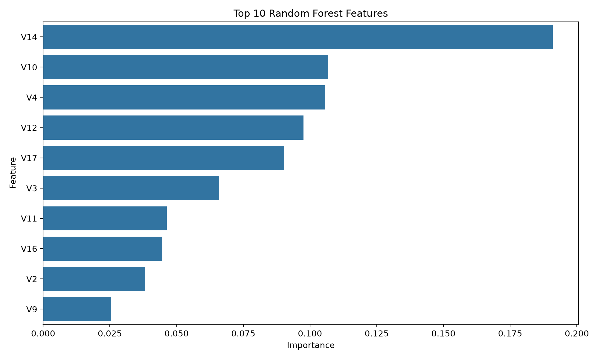

# 💳 Credit Card Fraud Detection & Risk Analytics


## 📌 Project Overview

A machine learning and data analytics project that identifies potentially fraudulent credit card transactions using Python, SQL, and Power BI.

## 🎯 Business Problem

Credit card fraud detection is a highly imbalanced classification problem. This project analyzes transaction patterns and compares machine learning models to help identify fraudulent activity.

## 📊 Dataset

- Total transactions: 284,807
- Fraudulent transactions: 492
- Genuine transactions: 284,315
- Fraud rate: approximately 0.173%

Dataset source: [Kaggle Credit Card Fraud Detection](https://www.kaggle.com/datasets/mlg-ulb/creditcardfraud)

Download `creditcard.csv` separately and place it in the `data/` folder. The raw dataset is not included in this repository.

## 🛠️ Tools & Technologies

- Python, Pandas, NumPy
- Matplotlib, Seaborn
- Scikit-learn
- SQL and SQLite
- Microsoft Power BI
- Git and GitHub

## 🤖 Machine Learning Models

- Logistic Regression
- Random Forest

### Model Performance

| Metric | Logistic Regression | Random Forest |
|---|---:|---:|
| Accuracy | 97.55% | 99.95% |
| Precision | 60.70% | 90.59% |
| Recall | 91.84% | 78.57% |
| F1-score | 71.44% | 84.15% |
| ROC-AUC | 97.21% | 95.73% |

These are the results from this project's experiment. Logistic Regression achieved higher recall, while Random Forest achieved higher precision and F1-score.

## 🗄️ SQL Analysis

SQL queries analyze:
- Total transactions
- Fraud versus genuine transactions
- Fraud percentage
- Average transaction amount by class
- Maximum transaction amount by class

## 📈 Power BI Dashboard

The Power BI dashboard presents transaction KPIs, fraud statistics, model comparisons, and feature importance.

**Dashboard file:** `fraud_dashboard.pbix`

## 🚀 How to Run

1. Download or clone this repository.
2. Install the required libraries:

```bash
pip install -r requirements.txt
```

3. Download the Kaggle dataset and put `creditcard.csv` inside `data/`.
4. Run the main Python script from the project root:

```bash
python src/fraud_detection.py
```

5. Run the SQL analysis scripts if their files are present:

```bash
python src/sql_setup.py
python src/run_sql_analysis.py
```

## 💡 Key Learnings

- Analyzing highly imbalanced financial data
- Comparing machine learning classification models
- Evaluating precision, recall, F1-score, and ROC-AUC
- Performing SQL-based fraud analysis
- Creating business-focused Power BI visualizations

## 👩‍💻 Author

**Kirti Rajput**

MBA — Data Science & AI

[GitHub Profile](https://github.com/KirtiMBA0910)   

## 📊 Exploratory Data Analysis (EDA)

### 1. Fraud vs Genuine Transactions


### 2. Transaction Amount by Class


### 3. Transaction Time Analysis


### 4. Correlation Heatmap


### 5. Random Forest Confusion Matrix


### 6. ROC Curve


### 7. Feature Importance


## 📈 Power BI Dashboard

View the interactive dashboard by downloading
`fraud_dashboard.pbix` from this repository and opening it in Power BI Desktop.

## 🤖 Model Performance Comparison

| Metric | Logistic Regression | Random Forest |
|---|---:|---:|
| Accuracy | 97.55% | 99.95% |
| Precision | 60.70% | 90.59% |
| Recall | 91.84% | 78.57% |
| F1-Score | 71.44% | 84.15% |
| ROC-AUC | 97.21% | 95.73% |

### Key Findings
- Logistic Regression achieved higher recall in this experiment, identifying a larger proportion of fraud cases.
- Random Forest achieved higher precision and F1-score in this experiment.
- Accuracy alone is not sufficient for fraud detection because fraudulent transactions are rare.
- Model selection should consider the business cost of missed fraud and false alerts.
